

<a href="https://zyhloh.com"></a>

 

  

  


<a href="https://github.com/Zyhloh/Unofficial-EGL-Documentation"></a>

  


<a href="https://github.com/Zyhloh/artemis"></a>
<a href="https://github.com/Zyhloh/Discord-Plus"></a>
<a href="https://github.com/Zyhloh/SMI-Reborn-Steam-Manifest-Installer"></a>
<a href="https://github.com/Zyhloh/Unofficial-Crunchyroll-For-Desktop"></a>
<a href="https://github.com/Zyhloh/NoMoreLunarPlus"></a>
<a href="https://github.com/Zyhloh/VeloHook"></a>

  


<table>
  <tr>
    <td><a href="https://github.com/Zyhloh/better-casino"><b>better-casino</b></a></td>
    <td>MelonLoader mod that overhauls the Schedule 1 casino</td>
    <td><code>C#</code></td>
  </tr>
  <tr>
    <td><a href="https://github.com/Zyhloh/Netflix-For-Desktop"><b>Netflix for Desktop</b></a></td>
    <td>Unofficial Netflix client for Windows</td>
    <td><code>C#</code></td>
  </tr>
  <tr>
    <td><a href="https://github.com/Zyhloh/Downfall"><b>Downfall</b></a></td>
    <td>The official Downfall client for Valorant</td>
    <td><code>TypeScript</code> <code>Rust</code></td>
  </tr>
  <tr>
    <td><a href="https://github.com/Zyhloh/Nullex"><b>Nullex</b></a></td>
    <td>Open source alternative to SteamTools and LuaTools</td>
    <td><code>WIP</code></td>
  </tr>
  <tr>
    <td><a href="https://github.com/Zyhloh/BetterReadAll"><b>BetterReadAll</b></a></td>
    <td>BetterDiscord plugin that clears unreads across every server</td>
    <td><code>JavaScript</code></td>
  </tr>
  <tr>
    <td><a href="https://github.com/Zyhloh/veil"><b>Veil</b></a></td>
    <td>Veil desktop app, archived</td>
    <td><code>TypeScript</code></td>
  </tr>
</table>

 


 

  



  

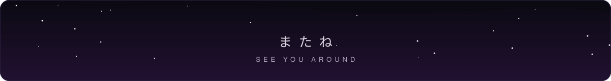

